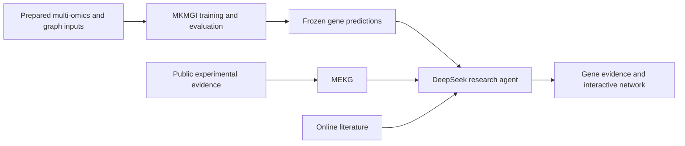

# MKMGI × MEKG

**Maize kernel-development gene prioritization and evidence-based interpretation.**

MKMGI combines a small temporal Transformer, temporal attention pooling and two
residual relation-GCN layers. MEKG links the resulting gene scores to traceable
public evidence. A DeepSeek research agent searches literature, retrieves graph
records and explains the evidence through a web portal.

[中文说明](README_zh.md) · [Training & evaluation](docs/training.md) ·
[Knowledge graph](docs/mekg.md) · [Agent & web portal](docs/agent.md)



## Repository layout

| Directory | Purpose |
|---|---|
| `mkmgi/` | Final model, fold-specific preprocessing, nested training, reporting and genome-wide prediction |
| `evaluation/` | Logistic regression, RBF-SVM, gradient boosting, MLP, GCN and PageRank; input/component ablations |
| `mekg/` | Public evidence ingestion, B73 v5 coordinate handling, database assembly and queries |
| `agent/` | DeepSeek conversation agent, literature search, source checks, interaction network and web frontend |
| `requirements/` | Recorded model and agent environments |

The model starts with prepared gene-level arrays and fixed family-held-out
splits. Raw-read processing and manuscript drawing code are outside this repository.

## 1. Train and evaluate MKMGI

Create a model environment using `requirements/model-recorded.txt`, then use the
separately supplied input bundle described in the [training guide](docs/training.md).

```bash
python mkmgi/prepare.py --inputs /data/model-inputs --workspace /data/new-model-run
export MKMGI_WORKSPACE=/data/new-model-run
python mkmgi/freeze.py
python mkmgi/run.py
```

The final table is
`predictions/genomewide_time_gcn_consensus.tsv.gz`. It supplies the priority score,
percentile, seed variability and coverage shown by the portal.

## 2. Build or query MEKG

Restore the versioned base graph and source-data bundle, then run the public
evidence stages in the [graph guide](docs/mekg.md).

```bash
python mekg/build.py public-v3 --workspace /data/mekg
python mekg/build.py tf-peaks --workspace /data/mekg
python mekg/query.py --db /data/mekg/v31/release/mekg.sqlite --gene YOUR_B73_V5_ID
```

The two build commands illustrate individual stages, not the complete build.

## 3. Start the research portal

Use an environment with `requirements/agent-recorded.txt` and NumPy for index
preparation. The [deployment guide](docs/agent.md) lists the artifact paths.

```bash
python agent/setup.py --model-root /data/new-model-run \
  --kg-database /data/mekg/v31/release/mekg.sqlite \
  --source-root /data/graph-and-curation --share-model-summary
export DEEPSEEK_API_KEY=YOUR_PROVIDER_KEY
python -m uvicorn app:app --app-dir agent --host 127.0.0.1 --port 8788
```

## Reproducibility

Model equations, training functions, hyperparameter grids and graph operations
come from the final study implementation. This edition consolidates imports and
replaces server-specific directories with workspace settings. Its new OOF table
reporter uses the original metric/bootstrap functions.

Gene scores are experimental priorities. Attention weights and public
associations support interpretation; they do not establish causal phenotypes.
Unlabelled genes remain unlabelled in the evaluation interpretation.

Input data, weights and the evidence database are distributed separately.
**Repository URL, data archive identifiers, software DOI and licence are pending.**
The scope and wording for the manuscript are in [Code availability](CODE_AVAILABILITY.md).
